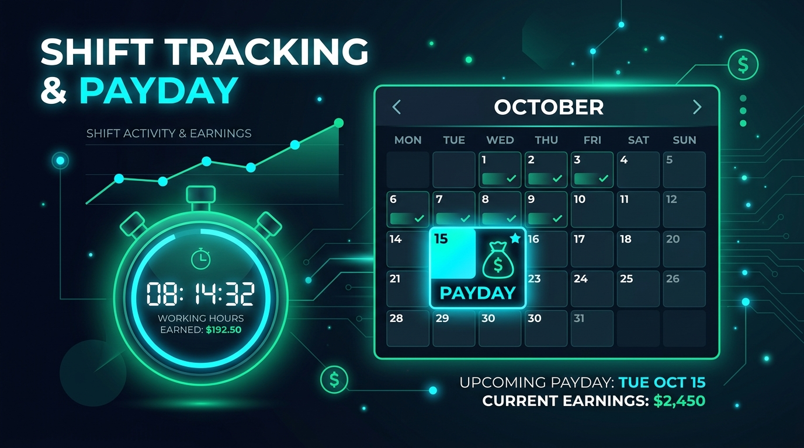

<p align="center">
  
</p>

# ⏱ Mesai Takip — Kilit Ekranı Sayacı & Salı Maaş Günü Takipçisi

<p align="center">
  
  
  
  
  
</p>

**Mesai Takip**, telefonunuzun kilit ekranını açmanıza bile gerek kalmadan tek dokunuşla çalışma saatlerinizi kaydeden, pilinizi harcamayan ve **Pazartesi'den Pazar'a haftalık mesai hesaplayıp her Salı maaş gününüzü ve kazancınızı takip eden** modern bir Android uygulamasıdır.

---

## 📲 APK İndirme (Tek Tıkla Kurulum)

Uygulamanın hazır `.apk` dosyasını telefonunuza yüklemek için aşağıdaki iki yöntemden birini kullanabilirsiniz:

### 🌟 1. Yöntem: GitHub Releases (En Kolay)
1. Bu GitHub sayfasının sağ tarafında yer alan **[Releases (Sürümler)]** bölümüne tıklayın (veya doğrudan [Releases sekmesine gidin](../../releases)).
2. **`MesaiTakip.apk`** dosyasına tıklayarak indirin.
3. İndirilen dosyaya dokunarak telefonunuza kurun!

### ⚙️ 2. Yöntem: GitHub Actions (Otomatik Derleme)
1. Bu reponun üst menüsündeki **"Actions"** sekmesine gidin.
2. En üstteki başarılı **"Build Android APK"** iş akışına tıklayın.
3. Sayfanın en altındaki **Artifacts (Yapıtlar)** kısmından **`MesaiTakip-APK`** paketini indirin.

> **💡 İpucu (Bilinmeyen Kaynaklar Uyarısı):** Google Play dışından indirilen tüm APK'larda Android varsayılan olarak güvenlik uyarısı verir. Kuruluma devam etmek için *"Bu kaynaktan yüklemeye izin ver"* seçeneğini onaylamanız yeterlidir.

---

## ✨ Öne Çıkan Özellikler

### 🔒 1. Kilit Ekranından Başlat ve Bitir (3 Farklı Yol)
* **Kilit Ekranı Canlı Bildirimi:** Mesai başladığında kilit ekranında canlı kronometre belirir. Kilidi açmadan doğrudan **`⏹ MESAİYİ BİTİR`** butonuna basarak vardiyanızı kaydedebilirsiniz.
* **Hızlı Ayarlar Kutucuğu (Quick Settings Tile):** Ekranı yukarıdan aşağı kaydırıp bildirim çekmecesindeki *"Mesai Takip"* kutucuğuna tek dokunuşla basarak kilitsiz başlatıp bitirebilirsiniz.
* **Kilit Ekranı Widget'ı (Keyguard AppWidget):** Cihazınızın kilit veya ana ekranına widget ekleyip `[▶ BAŞLAT]` ve `[⏹ BİTİR]` kontrollerini kullanabilirsiniz.

---

### 🔋 2. Gerçek Pil Dostu Mimari (Sıfır Arka Plan Tüketimi)
Arka planda pil tüketen sürekli işlemci döngüleri veya uyanık kalma kilitleri (wake-lock) **asla çalışmaz**.  
* Başla dediğiniz an: **Başlangıç zamanı damgalanır.**
* Bitir dediğiniz an: **Bitiş zamanı damgalanır ve aradaki fark hesaplanarak veritabanına kaydedilir.**
* CPU uyumaya devam eder, telefonunuzun şarjı asla tükenmez!

---

### 💰 3. Pazartesi — Pazar Döngüsü & Salı Maaş Günü Hesabı
* **Haftalık Mesai Takibi:** Verileriniz tam olarak **Pazartesi 00:00 ile Pazar 23:59** arasında haftalık olarak toplanır.
* **Salı Maaş Günü Kartı:** Bir sonraki Salı maaş gününe kalan gün sayacı, o hafta biriken toplam mesai saati ve hak ettiğiniz toplam para tutarı gösterilir.
* **Maaşımı Aldım Butonu:** Salı günü maaşınızı tahsil ettiğinizde tek tıkla *"Ödendi"* olarak işaretleyebilirsiniz.
* **Geriye Dönük Hafta İnceleme:** Önceki ve sonraki haftalar arasında gezinerek geçmiş kazanç arşivinize ulaşabilirsiniz.

---

### 📊 4. İnteraktif Haftalık Mesai Grafiği
* Pazartesi'den Pazar'a 7 günün çalışma saatlerini gösteren şık çubuk grafik.
* Bugünün ve **Salı Maaş Günü**'nün barları özel renk ve simgelerle vurgulanır.
* Barlara dokunarak o günkü mesai sürenizi ve kazancınızı inceleyebilirsiniz.

---

### 💵 5. Saatlik Ücret & Otomatik Kazanç Projeksiyonu
* Saatlik çalışma ücretinizi (örn. 250 ₺/saat) dilediğiniz gibi ayarlayabilirsiniz.
* Canlı sayaç çalışırken anlık kazancınızı kuruşu kuruşuna ekranda gösterir.
* Manuel vardiya ekleme, mola süresi düşme ve geçmiş vardiyaları düzenleme desteği.

---

### 🛡️ 6. %100 Çevrimdışı ve Gizlilik Odaklı (API Key Gerekmez)
* Uygulama hiçbir dış sunucuya veya üçüncü taraf servise bağlanmaz.
* API anahtarı veya hesap oluşturma gerekmez.
* Tüm verileriniz yalnızca telefonunuzun yerel SQLite veritabanında saklanır.

---

## 🛠️ Teknik Altyapı

* **Mimari:** MVVM (Model-View-ViewModel) + Repository Pattern
* **Kullanıcı Arayüzü:** Jetpack Compose (Material Design 3, Dark & Light Mode)
* **Veritabanı:** Android Room Persistence Library (SQLite)
* **Asenkron İşlemler:** Kotlin Coroutines & Flow
* **Sistem Entegrasyonu:** AppWidgetProvider (`keyguard|home_screen`), TileService (Quick Settings), NotificationCompat (Ongoing Public Chronometer)
* **CI/CD:** GitHub Actions otomatik APK derleme iş akışı

---

## 💻 Geliştirici Kurulumu (Kaynak Koddan Çalıştırma)

Projeyi kendi bilgisayarınızda derlemek isterseniz:

```bash
# Repoyu klonlayın
git clone <REPO_URL>
cd mesai-takip

# Debug APK derleyin
./gradlew assembleDebug

# Derlenen APK dosyasını bulun:
# app/build/outputs/apk/debug/app-debug.apk
```

---

<p align="center">
  <b>Mesai Takip</b> ile çalışma saatlerinizi ve hak ettiğiniz maaşınızı zahmetsizce takip edin! ⏱️💼
</p>
